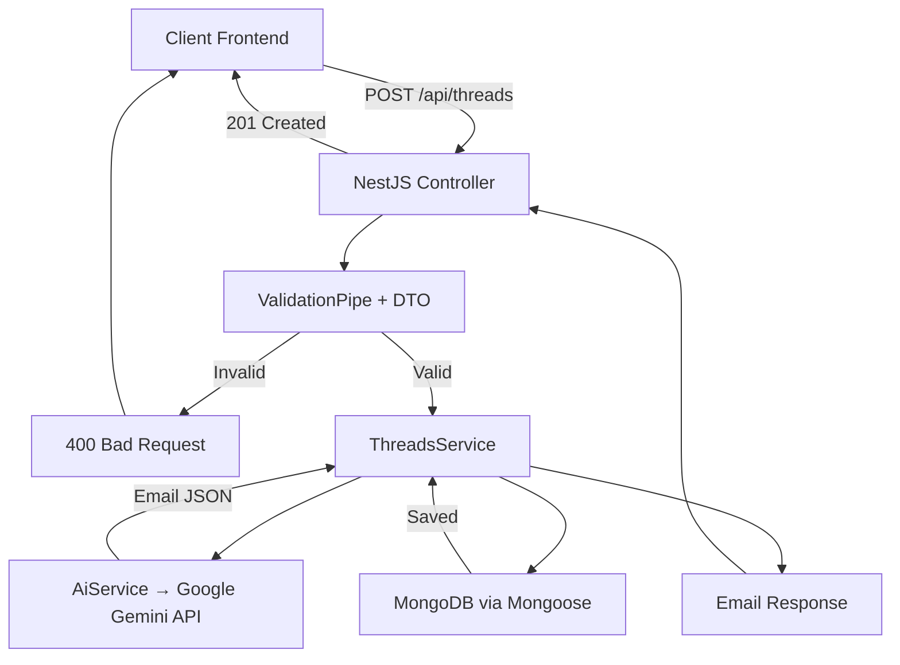

# AI Email Generator API 🚀 (NestJS Edition)

Hi! This is my AI Email Generator backend API, now rebuilt using **NestJS**. It helps people write emails faster using AI. It uses MongoDB to save all the data and Google Gemini to generate emails. It's really cool because it remembers the emails you already sent and can reply to them with full context!

## What it uses:
- **NestJS** (TypeScript) — modular backend framework with Dependency Injection
- **MongoDB** + **Mongoose** — to save the emails and threads
- **Google Gemini AI** — the LLM that writes emails
- **class-validator** — runtime DTO validation with decorators
- **@nestjs/throttler** — built-in rate limiting
- **@nestjs/config** — environment variable management

## How to run my project on your computer:
1. First, download or clone my code.
2. Open your terminal and type:
   ```
   npm install
   ```
3. Make a file named `.env` inside the folder and paste this. You need your own keys!
   ```env
   MONGODB_URI=your_mongo_db_url_here
   GEMINI_API_KEY=your_google_ai_key_here
   ```
4. Run the code:
   ```
   npm run start:dev
   ```

## Routes you can test
I used Postman to test these out:

- **Create a new email:** `POST /api/threads`
  Send JSON with a `prompt` (what the email is about), `recipientName`, and `tone`.
- **See all emails:** `GET /api/threads`
- **Get thread details:** `GET /api/threads/:id`
- **Reply to an email:** `POST /api/threads/:id/reply`
  (Replace `:id` with your actual thread ID from the database) and send it a `replyInstruction`.

## Why I built this:
Sometimes I get stuck trying to figure out what to say in an email, and remembering the whole conversation gets confusing. I wanted to build an API that saves the entire conversation so the AI can write super accurate replies for me automatically. Plus, I really wanted to practice building APIs with NestJS and MongoDB!

## High-Level Architecture



## Project Structure
```
src/
├── ai/                    # AI module (Gemini integration)
│   ├── ai.module.ts
│   ├── ai.service.ts
│   └── ai.service.spec.ts
├── common/                # Shared utilities
│   ├── exceptions/
│   │   └── api.exception.ts
│   └── filters/
│       └── http-exception.filter.ts
├── schemas/               # Mongoose schemas
│   ├── email.schema.ts
│   └── email-thread.schema.ts
├── threads/               # Threads feature module
│   ├── dto/
│   │   ├── create-thread.dto.ts
│   │   └── reply-thread.dto.ts
│   ├── threads.controller.ts
│   ├── threads.module.ts
│   └── threads.service.ts
├── app.module.ts          # Root module
└── main.ts                # Entry point
```

## Things I want to add later (Improvements):
- Add WebSocket support for real-time email generation status
- Implement background job processing with Bull queues
- Add Swagger/OpenAPI documentation
- Add authentication and user management

## How to run it with Docker!
If you know how to use Docker, I also made it ready for containers!
1. Build the image:
   ```bash
   docker build -t my-email-api .
   ```
2. Run it (don't forget to put your real keys!):
   ```bash
   docker run -p 3000:3000 -e GEMINI_API_KEY="your_ai_key" -e MONGODB_URI="your_db_url" my-email-api
   ```

Thanks for checking out my project! I learned a lot about NestJS, Dependency Injection, modular architecture, and prompting AI while making it.
