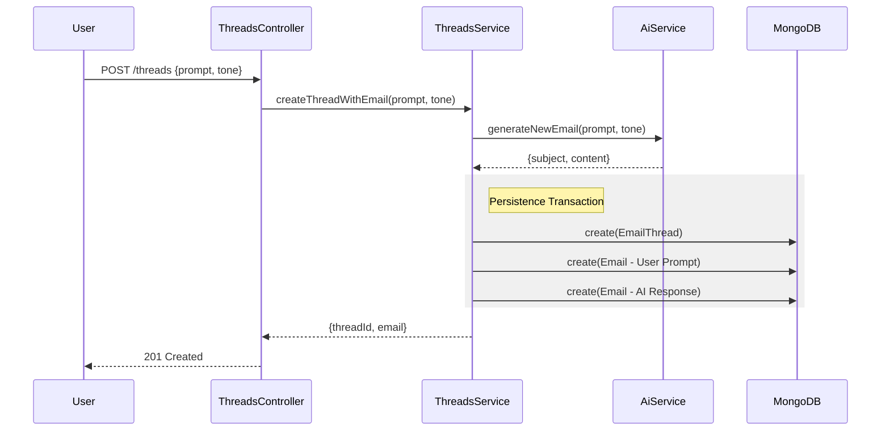
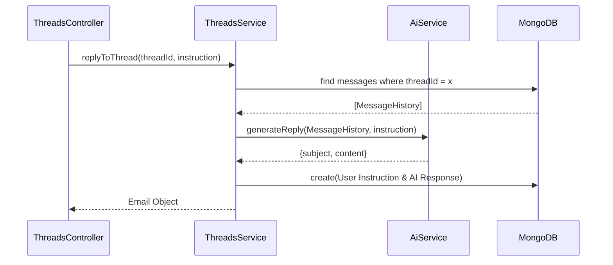

# AI Email Generator API: Low-Level Design & Workflow

This document provides a technical deep-dive into the NestJS architecture of the AI Email Generator API, including component interactions, dependency maps, and a detailed end-to-end workflow of the AI generation process.

---

## 1. Project Architecture Overview

The application is built using **NestJS**, following a modular design pattern with **Dependency Injection (DI)** at its core.

- **AppModule**: The root module that bootstrap the application and handles global configurations (MongoDB, Configuration, Rate Limiting).
- **ThreadsModule**: Encapsulates the core business logic for managing email threads.
- **AiModule**: Handles all interactions with the Google Gemini AI API.
- **Common**: Contains shared filters, exceptions, and utility classes.

---

## 2. Dependency Injection Map

The following table illustrates the provider dependencies between components:

| Consumer Component | Injected Provider | Purpose |
| :--- | :--- | :--- |
| `ThreadsController` | `ThreadsService` | Handles HTTP requests and delegates logic. |
| `ThreadsService` | `AiService` | Requests AI generation for new emails and replies. |
| `ThreadsService` | `Model<EmailThread>` | Mongoose model for persisting thread metadata. |
| `ThreadsService` | `Model<Email>` | Mongoose model for persisting individual messages. |
| `AiService` | `ConfigService` | Fetches environment variables (API Key, Model ID). |

---

## 3. Function & Method Inventory

### 📂 ThreadsController
*Primary entry point for external API consumers.*

- `createThread(@Body createThreadDto)`
  - Calls: `threadsService.createThreadWithEmail()`
- `getAllThreads()`
  - Calls: `threadsService.getThreads()`
- `getThread(@Param threadId)`
  - Calls: `threadsService.getThreadDetails()`
- `replyToThread(@Param threadId, @Body replyThreadDto)`
  - Calls: `threadsService.replyToThread()`

### 📂 ThreadsService
*Orchestrates the business logic and database persistence.*

- `createThreadWithEmail(prompt, tone, recipientName)`
  - 1. Calls `aiService.generateNewEmail()`
  - 2. Creates `EmailThread` document.
  - 3. Creates `Email` document (Role: User) for the prompt.
  - 4. Creates `Email` document (Role: Assistant) for the AI result.
- `getThreads()`
  - Calls `emailThreadModel.find()`
- `getThreadDetails(threadId)`
  - 1. Calls `emailThreadModel.findById()`
  - 2. Calls `emailModel.find({ threadId })`
- `replyToThread(threadId, instruction, overrideTone)`
  - 1. Fetches history via `emailModel.find()`.
  - 2. Calls `aiService.generateReply(history, ...)`.
  - 3. Saves the User instruction and AI assistant response to the DB.

### 📂 AiService
*Handles interaction with Google Gemini Pro.*

- `generateNewEmail(prompt, tone, recipientName)`
  - Constructs a prompt for a "new" email context.
- `generateReply(history, instruction, tone, recipientName)`
  - Constructs a prompt that includes the full conversation history for context-aware replies.
- `parseGeminiResponse(text)`
  - Cleans AI output and parses the JSON string into an object.
- `handleGeminiError(error, context)`
  - Translates Gemini API errors (429 Rate Limit, 403 Permission) into user-friendly exceptions.

---

## 4. End-to-End Workflow & Call Flows

### Workflow: Creating a New AI Email Thread

The sequence below shows how a single request travels through the system:

### Workflow: Replying to an Existing Thread

This workflow demonstrates **context-awareness** by including previous messages in the AI prompt:

---

## 5. Data Flow & Validation

1. **Incoming Request**: User sends JSON to `/threads`.
2. **DTO Validation**: `CreateThreadDto` validates types (e.g., `@IsEnum(ToneEnum)`).
3. **Service Logic**: `ThreadsService` converts primitive strings into Mongoose document shapes.
4. **AI Processing**: Data is formatted as a structured prompt for LLM consumption.
5. **Persistence**: `MongooseModule` saves the final structured data to MongoDB collections (`emailthreads` and `emails`).
6. **Response**: The Controller returns a cleaned object (typically via `.lean()`) to the client.

---

## 6. Error Handling Strategy

- **Rate Limiting**: `ThrottlerGuard` blocks excessive requests at the Controller level (5 req / 30s).
- **Service Errors**: `NotFoundException` (custom) is thrown if a Thread ID doesn't exist.
- **AI Failures**: `AiService` catches API errors (like Quota Exceeded) and throws clear domain errors.
- **Global Filter**: `HttpExceptionFilter` (in `common/filters`) catches all outgoing errors to ensure a consistent JSON response format.
